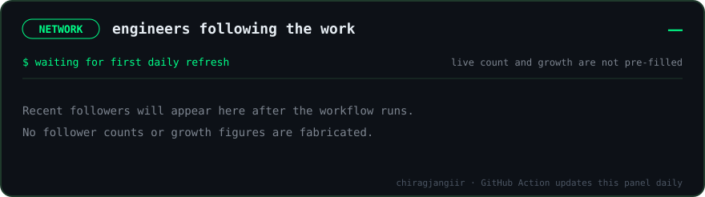

<div align="center">


**AI systems, developer tools, and the patches that make them better.**

<a href="https://github.com/chiragjangiir"></a>

<sub>Profile snapshot refreshes daily through GitHub Actions.</sub>

</div>

<br />

### `01` `cat about.txt`

I'm Chirag Jangir, a B.Tech Computer Science student specializing in AI & Machine Learning at Galgotias University.

I learn by building things, reading real codebases, and contributing fixes upstream. My interests sit at the intersection of AI engineering, developer tools, backend systems, and open source.

> Prompts are drafts. Reliable systems are built through loops, tests, and iteration.

### `02` `git log --oneline selected-work`

- **Cloud Vault** — A cloud-storage application built with Spring Boot, Thymeleaf, and REST APIs.
- **UIDAI Data Analysis** — Exploring Aadhaar enrolment and update trends through data preprocessing, aggregation, and analytical indices.
- **BatchZero** — Exploring the idea of a campus memory engine.
- **AI & developer tooling** — Experiments with machine learning, LLM applications, agents, and developer workflows.

→ [Browse repositories](https://github.com/chiragjangiir?tab=repositories)

### `03` `git remote -v`

Open source is where I put learning into practice: understanding unfamiliar repositories, reproducing issues, writing focused fixes, improving tests, and responding to review feedback.

Areas I’m especially interested in:

- AI agents, LLM tooling, and observability
- Developer tools and engineering infrastructure
- Backend systems, tests, and documentation
- Practical machine-learning applications

→ [Explore my GitHub activity](https://github.com/chiragjangiir?tab=activity)

### `04` `ls ~/toolbox`

```text
languages/       Python · Java · C · C++ · JavaScript
ai-data/         Machine Learning · NumPy · Pandas · Jupyter
llm-systems/     LLM applications · RAG · agent workflows
engineering/    Spring Boot · REST APIs · Git · SQL · Docker
```

### `05` `ps aux | grep currently-learning`

```text
[active]  Contributing to real-world open-source repositories
[active]  Exploring AI agents and developer tooling
[active]  Improving debugging, testing, and code review
[active]  Shipping practical projects from idea to implementation
```

### `06` `man collaboration`

I'm interested in collaborating on AI/ML applications, LLM infrastructure, open-source fixes, backend systems, and tools that make developers more productive.

I value small, reviewable changes, reproducible bugs, meaningful tests, and honest documentation.

### `07` `exit 0`

If you're building something interesting, explore my repositories or connect through GitHub.

**Build something useful. Make it better. Send the patch.**

<sub>Maintained by Chirag Jangir · Built in public, one contribution at a time.</sub>
