**AI/ML, GenAI, developer tools, and open source — built one useful contribution at a time.**

I work across AI applications and developer tooling — exploring how systems behave, how they fail, and how small engineering changes make them more reliable.

## `01 / FIELD NOTES`

My interests sit at the intersection of **intelligent software** and the infrastructure around it: model integrations, developer workflows, observability, testing, and the details that make software dependable.

I prefer learning a codebase by tracing the behavior, reading the tests, and understanding the constraints before changing it. That approach shapes both my independent projects and my contributions to existing open-source tools.

<code>BACKGROUND</code>

B.Tech · Computer Science and Engineering (AI & ML)

## `02 / PROJECTS & OPEN SOURCE`

A curated selection of things I build, maintain, and contribute to across AI systems, agent tooling, and developer infrastructure.

### Start Here
- ☁️ [Cloud Vault](https://github.com/chiragjangiir/Cloud_Vault) — Secure, scalable cloud storage platform inspired by Google Drive with clean access control.
- 🎯 [internship_autopilot](https://github.com/chiragjangiir/internship_autopilot) — Human-in-the-loop AI application assistant: deep company research, verified outreach, and staged email delivery.
- ⚙️ [wheelgap](https://github.com/wheelgap/wheelgap) — Fast preflight tool catching Python dependencies without wheels for ARM, Alpine, and free-threaded 3.14t.
- 🤖 [DevAgent](https://github.com/knight22-21/DevAgent) — Terminal-first AI agent bridging product specifications with production codebases.

### Current Projects & Open Source

#### AI Agents, Observability & Gateway
- 🛡️ [HaltAI](https://github.com/IkarusAILabs/HaltAI) — Containability assurance and deployment-bound claim validation for autonomous agents.
- 🗜️ [headroom](https://github.com/headroomlabs-ai/headroom) — LLM context compression proxy keeping core orchestration tools resident while compressing noisy tool outputs.
- 🔍 [OpenPulse](https://github.com/IkarusAILabs/OpenPulse) — Open-source dependency intelligence: tracking EOL, license, distribution, and security events with verifiable proof.
- 🌐 [mcp-context-forge](https://github.com/IBM/mcp-context-forge) — Enterprise AI Gateway and proxy layer orchestrating Model Context Protocol (MCP) servers and tool execution.
- 📊 [openllmetry](https://github.com/traceloop/openllmetry) — OpenTelemetry-based observability, tracing, and metric instrumentation for LLM workflows.

#### Developer Tooling & Infrastructure
- 🧪 [dex](https://github.com/exmergo/dex) — Agent-native analytics engineering toolkit for dbt: schema drift detection and transformation planning.
- 📦 [pypa/build](https://github.com/pypa/build) — Core packaging frontend for building Python source trees into wheels and sdists.
- ⚡ [anyio](https://github.com/agronholm/anyio) — High-level asynchronous concurrency and networking framework bridging asyncio and trio.
- 🧩 [testcontainers-aws](https://github.com/manojkken/testcontainers-aws) — Deterministic cloud integration testing orchestrating LocalStack in containerized test suites.

#### Media Engines & Web Systems
- 🎬 [reframe](https://github.com/reframe-oss/reframe) — In-browser, client-side video editor powered by WebAssembly FFmpeg and accessible canvas rendering.
- 🎥 [MoneyPrinterTurbo](https://github.com/harry0703/MoneyPrinterTurbo) — Automated end-to-end video synthesis pipeline using LLM scripts, TTS, and timeline generation.
- 🎵 [mutagen](https://github.com/quodlibet/mutagen) — Audio metadata processing engine supporting FLAC, MP3, and OGG stream operations.

## `03 / WORKING SET`

**AI & model applications**  
LLM integrations · RAG concepts · AI agents · machine learning · data analysis

**Developer tooling**  
CLI workflows · APIs · debugging · testing · observability · developer experience

**Languages & foundations**  
Python · Java · C++ · JavaScript · SQL · Git

**Libraries & tools**  
NumPy · Pandas · scikit-learn · Matplotlib · Jupyter · Docker · Vercel

This is a map of the areas I work in, not a claim of equal depth across every tool.

## `04 / PRINCIPLES`

- **Understand before changing.** Read the surrounding code and tests before proposing a fix.
- **Prefer evidence over theater.** Reproducible behavior matters more than impressive labels.
- **Keep the surface small.** Focused changes are easier to review, test, and maintain.
- **Build in the open.** Useful software improves through clear documentation and thoughtful review.

---

`INDEPENDENT ENGINEERING` &nbsp; / &nbsp; `AI SYSTEMS` &nbsp; / &nbsp; `OPEN SOURCE`

[GitHub](https://github.com/chiragjangiir) · [Repositories](https://github.com/chiragjangiir?tab=repositories) · [Achievements](https://github.com/chiragjangiir?tab=achievements)

Interested in practical AI, developer infrastructure, and open-source work that solves a real problem.

